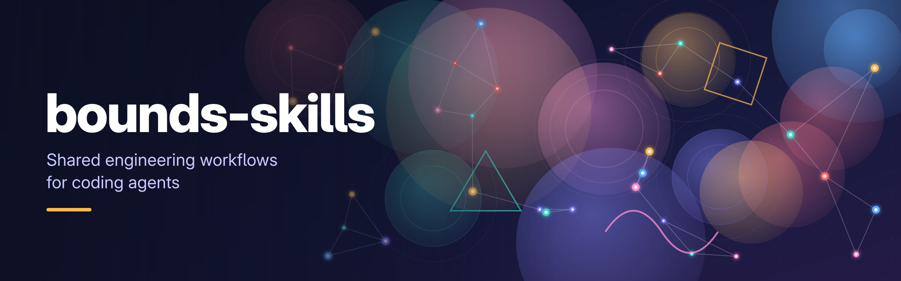

<p align="center">
  
</p>

> [!NOTE]
> **Built for one person's workflow, shared as an example.** These skills draw on work by [Matt Pocock](https://github.com/mattpocock/skills), [Lauren Tan (pstack)](https://github.com/cursor/plugins/tree/main/pstack), [Theo Browne (tstack)](https://github.com/t3dotgg/tstack) and [Emil Kowalski](https://github.com/emilkowalski/skills). I've customized them heavily for the way I work. I'm sharing them so others can borrow ideas, read how they're built, or fork them. They're tuned to my habits, so expect to adapt them before they fit yours.

# bounds-skills

A library of engineering skills for coding agents like **Codex** and **Claude Code**. Each skill teaches the agent one way of working well: reproduce a bug before fixing it, check a number before reporting it, review a change against what was actually asked.

The goal is simple: **less of your time spent correcting the agent, and more work you can trust.**

## Two ways to use a skill

**1. Call it by name.** Type the skill name at the start of your message. Claude Code uses a slash, Codex uses a dollar sign:

```text
/bounds-debug the second page of results repeats the first page    (Claude Code)
$bounds-debug the second page of results repeats the first page    (Codex)
```

**2. Just ask.** Describe what you want in plain words. The agent reads each skill's description and picks up the one that fits:

```text
Page 2 of the results shows the same rows as page 1. Can you figure out why and fix it?
```

Calling a skill by name is the sure way. Plain requests work most of the time, but the agent decides. A couple of skills only run when you ask for them. They are marked **Manual only** or **Only on request** below.

The examples below use the Claude Code form (`/bounds-...`). In Codex, swap the `/` for `$`.

## Start here

### bounds-mode · Manual only
Hands your task to the right Bounds skills and carries it through to checked, finished work, without turning a small fix into a big process. It never starts by itself; type it when you want the whole Bounds way of working for a task. Say "stop using bounds-mode" to turn it off.

- **By name:** `/bounds-mode fix this failing import and confirm the original error is gone`

### bounds-help
Points you to the right skill for a job, or helps you word a better prompt, without starting the work.

- **By name:** `/bounds-help which skill should I use to understand a design decision?`
- **Just ask:** "Which of the Bounds skills would help me figure out why this code is built this way?"

## Plan and design

### bounds-plan
Turns an idea into a short plan: what's in scope, what must keep working, how you'll know it's done, and what it depends on.

- **By name:** `/bounds-plan add CSV export, keeping the current JSON API unchanged`
- **Just ask:** "Before we start, plan out CSV export. The JSON endpoint has to keep working."

### bounds-architect
Designs the shape of a bigger change before any code is written: who owns the state, the types, the interfaces. It compares a few real alternatives.

- **By name:** `/bounds-architect design offline draft sync that still works with old clients`
- **Just ask:** "How should we structure offline sync so we don't regret it later? Old clients still need to work."

### bounds-grill
Asks you questions in short rounds, each with a suggested answer, until every decision about an idea or plan is out in the open. For a new idea, it first checks whether the problem is real. Documentation is optional: only on request, it records agreed glossary terms and important decisions in the project.

- **By name:** `/bounds-grill question this order model and record agreed glossary terms and important decisions in this project's docs`
- **Just ask:** "Grill me on this order design, and save the vocabulary and important tradeoffs we agree on in this project."

### bounds-options
Builds two to four genuinely different versions of an undecided design behind a switcher, using realistic worst-case content. Then it waits for you to choose. It removes the switcher afterwards.

- **By name:** `/bounds-options show three directions for the onboarding screen`
- **Just ask:** "I'm not sure what onboarding should look like. Show me a few different takes before we commit."

## Understand code and facts

### bounds-how
Explains how existing code works, from where a request comes in to what it changes and where it ends up. The depth matches what you need.

- **By name:** `/bounds-how explain this request flow and its failure paths`
- **Just ask:** "Walk me through what happens when someone hits the checkout endpoint."

### bounds-why
Digs into why code or a design is the way it is, keeping cited evidence separate from guesses.

- **By name:** `/bounds-why why does this module retry exactly three times?`
- **Just ask:** "Why is the retry limit three? Was that a deliberate choice?"

### bounds-research
Answers one factual question from primary sources such as official docs, specs, release notes and installed versions. Every claim is dated and cited.

- **By name:** `/bounds-research does version 5 of this SDK still support background refresh?`
- **Just ask:** "Before we upgrade, can you check whether the new SDK version still supports background refresh?"

### bounds-recall
Recovers decisions and unfinished work from earlier sessions and project records, then checks what still holds today.

- **By name:** `/bounds-recall catch me up on this project across earlier sessions`
- **Just ask:** "Where did we leave off on the export feature last week?"

## Build and fix

### bounds-debug
Reproduces a bug, finds the cause, fixes it, and proves the fix with a check you can rerun.

- **By name:** `/bounds-debug the second page repeats the first page's rows`
- **Just ask:** "Page 2 shows the same rows as page 1. Find out why and fix it."

### bounds-measure
Checks a number before anyone trusts it: enough runs, no hidden errors, the right comparison. It ends with a clear verdict, or says the result is inconclusive.

- **By name:** `/bounds-measure check this 30% export speedup before it goes in the PR`
- **Just ask:** "Export went from 12 seconds to 9. Can I say it's 25% faster?"

### bounds-blast-radius
Traces what a change could break outside its own diff, such as callers, caches, saved data and other clients, and tests the assumption it depends on.

- **By name:** `/bounds-blast-radius what could this cache change break downstream?`
- **Just ask:** "I'm nervous about this cache change. What else could it affect?"

### bounds-dial
When a value judged by eye or feel, like an animation, a timing or a color, keeps coming out wrong, it builds a small dev-only control panel so you can tune it yourself. Then it applies the version you save.

- **By name:** `/bounds-dial build a tool to tune this sheet's spring`
- **Just ask:** "The sheet animation still feels off after three tries. Can you give me something I can adjust myself?"

## Review and ship

### bounds-review
Reviews a change for bugs, missed requirements and maintenance costs. It keeps real problems separate from style preferences.

- **By name:** `/bounds-review review this branch against main and SPEC.md`
- **Just ask:** "Can you review my branch before I open the PR?"

### bounds-ui-review
Reviews an interface the way a picky user would: keyboard and touch, accessibility, empty and error states, long content, layout and motion.

- **By name:** `/bounds-ui-review review the new checkout flow before it ships`
- **Just ask:** "Look over the new checkout screens before we ship. Check small screens, keyboard use and empty states."

### bounds-council · Only on request
Has one fresh reviewer from each available AI provider review the same change, plan or design, in a limited number of scored rounds. It only runs when you ask for a council; for a single review, use bounds-review.

- **By name:** `/bounds-council review this branch before it ships`
- **Just ask:** "Get a council review of this branch."

### bounds-ship
Takes a finished change through proof that it works, review and passing CI, ending with a PR that's ready to merge. It never merges unless you say so, and asks about deploying when that's unclear.

- **By name:** `/bounds-ship finish this change through a ready PR; don't merge`
- **Just ask:** "Wrap this up and get the PR ready. Don't merge it."

### bounds-modernize
Picks up a stale, conflicting or inherited PR, re-checks it against today's code, and brings it up to date while keeping credit for the original author.

- **By name:** `/bounds-modernize update PR #42 against its base`
- **Just ask:** "PR #42 has been sitting for a month. Can you rebase it and get it current?"

### bounds-leaving-pr-comments
Writes GitHub comments, reviews and replies for you, clearly marked as written by an AI on your behalf. It posts only when you've said it may.

- **By name:** `/bounds-leaving-pr-comments reply to this reviewer for me`
- **Just ask:** "Answer the reviewer's question on line 40 and post it."

## Verification recipes

### bounds-create-verification
Builds a repeatable recipe for your project: launch the app, check it's healthy, use it, capture proof, clean up. It runs the recipe to prove it works.

- **By name:** `/bounds-create-verification build a local recipe for this CLI`
- **Just ask:** "Set up a repeatable way for you to launch this app and prove a feature works."

### bounds-maintain-verification
Keeps that recipe accurate as the project changes. It tells you whether a failure means the docs are out of date, the tooling has a gap, or there's a real bug.

- **By name:** `/bounds-maintain-verification check the recipe after the search route changed`
- **Just ask:** "We renamed the search route. Make sure the verification recipe still works."

## Communicate

### bounds-ketchup
Catches you up on what happened in this conversation since your last real message: where things stand, what's blocked, and what needs your decision.

- **By name:** `/bounds-ketchup catch me up on this thread`
- **Just ask:** "I stepped away for an hour. What did I miss?"

### bounds-handoff
Writes a resume note so another agent, model or later session can pick up the work cold: Git state, what's verified and what isn't, open issues and the first next step. It's saved outside the repo and never committed.

- **By name:** `/bounds-handoff write a resume note before I switch providers`
- **Just ask:** "I'm about to hit my usage limit. Write up where we are so another agent can continue."

### bounds-bro
Says the last answer, or any text you give it, again in short, plain language. It keeps the decision, the caveats that matter and the next step.

- **By name:** `/bounds-bro say that again in plain language`
- **Just ask:** "That was a lot. Can you say it more simply?"

### bounds-unslop
Tightens writing you hand it so it reads direct and concrete, without changing what it claims.

- **By name:** `/bounds-unslop tighten this PR description without changing its claims`
- **Just ask:** "This README section is wordy. Make it clearer but keep every fact."

### bounds-post
Drafts a blog post from your own material, such as notes, a log or a merged PR, in your voice. It checks every claim against the source and removes private details. It never publishes.

- **By name:** `/bounds-post draft a post from last week's offline sync fix and its PR`
- **Just ask:** "Turn the sync bug we fixed last week into a blog post draft."

## Improve how you work

### bounds-retro
Looks back over a piece of work for repeated corrections and wasted effort, then suggests fixes to structure, checks or tooling rather than more rules to remember.

- **By name:** `/bounds-retro look at the repeated corrections in this task`
- **Just ask:** "I kept correcting you about the same thing this session. What should change so that stops?"

### bounds-automate-me
Turns how you like to work into a small, focused skill of your own, built from preferences you state and patterns in your past decisions.

- **By name:** `/bounds-automate-me draft a skill from how I like PRs written`
- **Just ask:** "Make a skill that captures how I like commit messages and PR descriptions."

### bounds-agent-docs
Keeps agent-facing docs like AGENTS.md short and accurate. It checks the commands actually work and adds design-system rules agents can follow.

- **By name:** `/bounds-agent-docs shorten this project's AGENTS.md and check its commands`
- **Just ask:** "Our AGENTS.md is long and half the commands are stale. Clean it up."

### bounds-cleanup
Frees disk space without losing work. It measures first, holds back anything uncommitted, unpushed or in use, and deletes only what you approve.

- **By name:** `/bounds-cleanup free space from old worktrees and build output`
- **Just ask:** "My disk is almost full. Clear out old worktrees and build caches, but don't lose anything."

## Craft skills (installed per project)

These two carry platform design guidance. Install them only in projects that build that kind of interface. Once installed, they load on their own whenever you work on UI there.

### bounds-web-craft
Interface craft for web UIs, covering typography, color, layout, forms, accessibility, motion and performance, checked in a real browser.

- **By name:** `/bounds-web-craft tighten the typography and spacing on the pricing page`
- **Just ask:** "The pricing page feels cramped. Fix the spacing and type."

### bounds-native-craft
Platform-correct interface craft for native apps, with Apple platforms covered first (SwiftUI, UIKit, AppKit).

- **By name:** `/bounds-native-craft make this settings screen hold up at the largest text size`
- **Just ask:** "This SwiftUI settings screen breaks at large text sizes. Can you fix it?"

## What the skills won't do

A skill never gives the agent extra permissions, installs dependencies when you use it, or sets up its own connections between machines. A typo stays a small edit. Anything outward-facing, like posting comments, merging, deploying or deleting, still needs your say-so.

## Install

Install with [`npx skills`](https://github.com/vercel-labs/skills) on each machine where you run Codex or Claude Code. Workflow skills go in globally. Craft skills go in per project. [docs/install.md](docs/install.md) has the exact commands for a pinned version, choosing only some skills, updating, checking status and removing.

After installing, start a fresh agent session and try one skill by name to confirm it loaded.

## Version

**0.4.0** (tag `v0.4.0`) adds council, handoff, measure, research, post and cleanup, and refreshes existing skills from newer upstream versions. See [validation](docs/validation.md) for what has been tested on which provider, and [compatibility](docs/compatibility.md) for provider differences.

## Develop

[SPEC.md](SPEC.md) is the design contract. Before sending a change, run:

```sh
python3 scripts/check.py
python3 -m unittest discover -s tests
```

[docs/validation.md](docs/validation.md) covers installer and provider checks in isolated homes. Keep test artifacts outside the repository.

## Credits and license

MIT licensed. Parts of this library are adapted from pinned versions of skills by Matt Pocock, Lauren Tan (pstack), Theo Browne (tstack) and Emil Kowalski. See [THIRD_PARTY.md](THIRD_PARTY.md) for sources, notices and what was changed.
